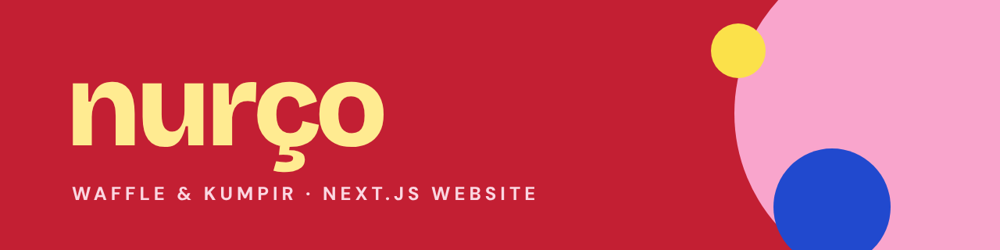
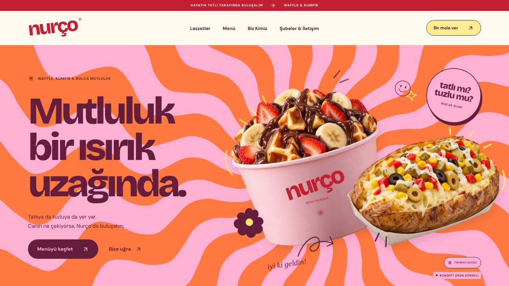
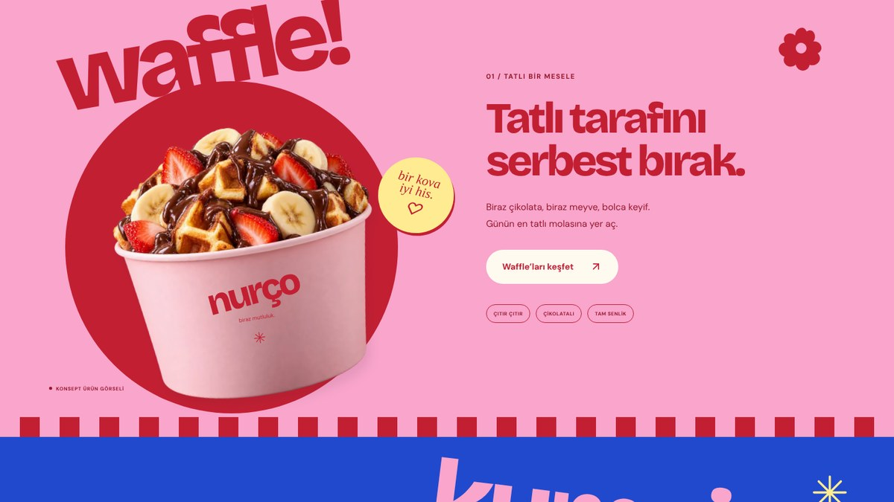
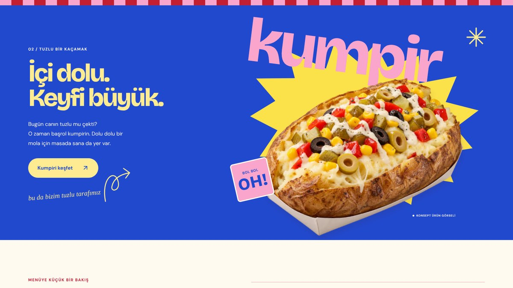
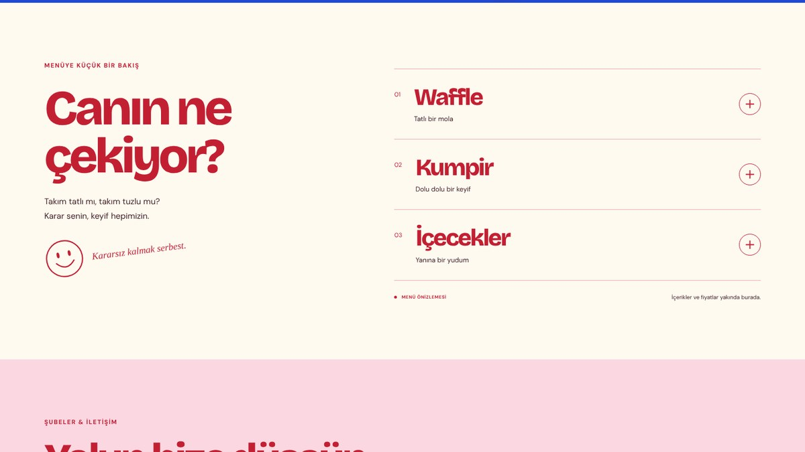
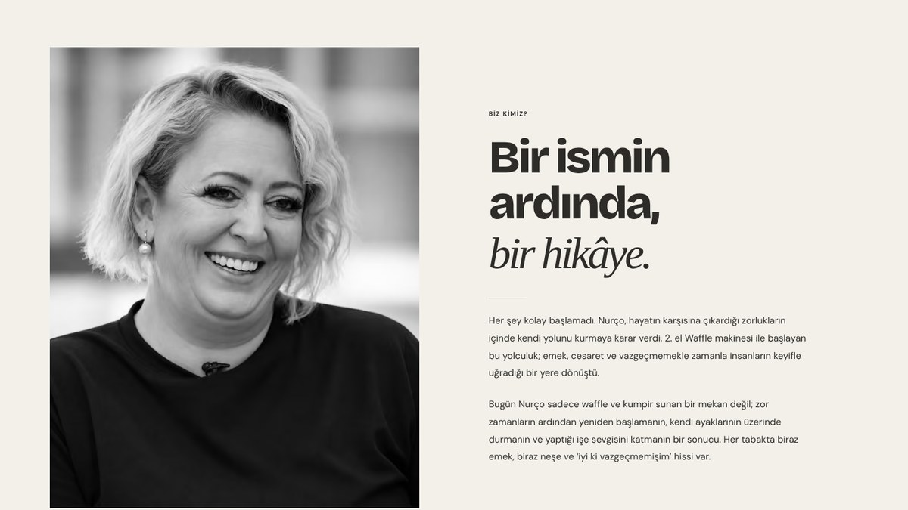
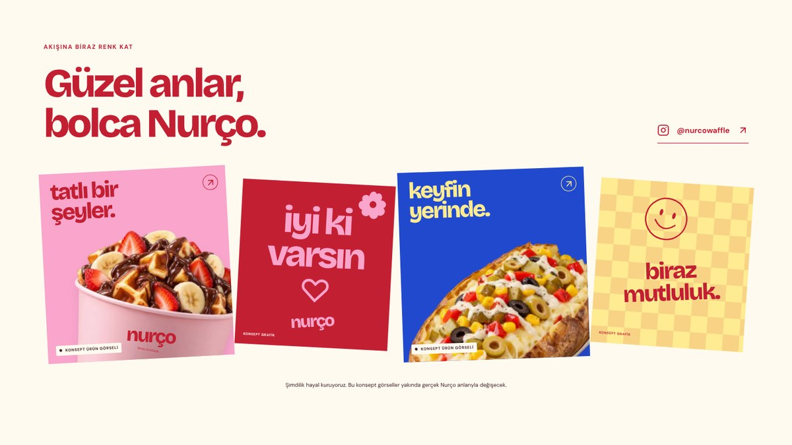
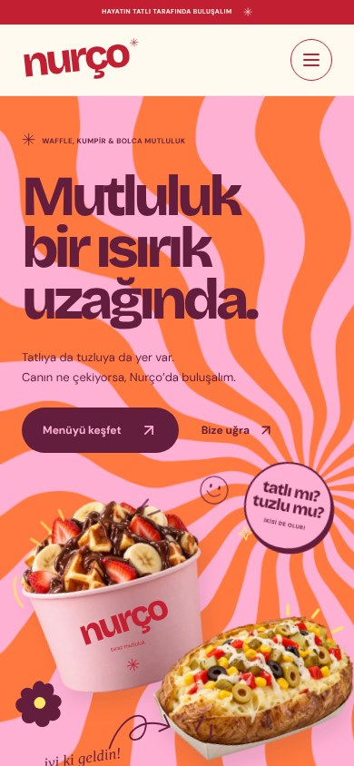

<p align="center">
  
</p>

<p align="center">
  <b>Nurço is a bright, poster-style website for a local waffle and kumpir shop.</b> It brings the brand's two products, a menu preview, branch details and an Instagram gallery into one fast, mobile-friendly page.
</p>

<p align="center">
  
  
  
  
  
</p>

<p align="center">
  <a href="https://nurco-website.vercel.app/"><b>Live preview → nurco-website.vercel.app</b></a>
</p>

---

## Features

- **Poster-style sections** — A yellow brand opening, a pink waffle poster and a cobalt-and-yellow kumpir poster, each with its own colors and layout.
- **Expandable menu preview** — Menu categories open and close in place, so the page stays short.
- **Branches and contact** — An illustrated neighborhood map with address, hours and call / directions buttons.
- **Instagram poster gallery** — A gallery that links out to the brand's Instagram.
- **Responsive by design** — Layouts checked from 390 px phones up to 2560 px screens.
- **Fast and private** — Fonts and images are served locally; no requests to Google Fonts or Instagram while the page loads.
- **Easy to edit** — Brand colors live as tokens in one CSS block, and menu, branch and image data live in one typed content file.

## Screenshots

<p align="center">
  
  
</p>
<p align="center">
  
  
</p>
<p align="center">
  
  
</p>
<p align="center">
  
</p>

## How It Works

A visitor lands on the yellow opening section with the tagline and two buttons, then scrolls through the waffle and kumpir posters, opens a menu category to see what is inside, and finds the branch with its address, hours and a call button. The page is a single Next.js App Router project written in TypeScript. Each section is its own component, text and menu data come from `src/lib/content.ts`, and colors come from the CSS tokens in `src/app/globals.css`. Product photos are placeholder visuals and the business details are marked as awaiting confirmation, so swapping in real photos and verified information only means editing the content file. The site is set to `noindex`, so search engines skip it.

## Setup

```bash
git clone https://github.com/emirhanoktay/nurco-website.git
cd nurco-website
npm ci
npm run dev -- --webpack
```

Open http://127.0.0.1:3000. Use `npm run typecheck` to check types and `npm run build` for a production build.

## Contact

<p align="center">
  <a href="https://www.linkedin.com/in/emirhanoktay"></a>
  <a href="https://instagram.com/emirhannoktayy"></a>
  <a href="mailto:emirhanoktayy1@gmail.com"></a>
</p>
